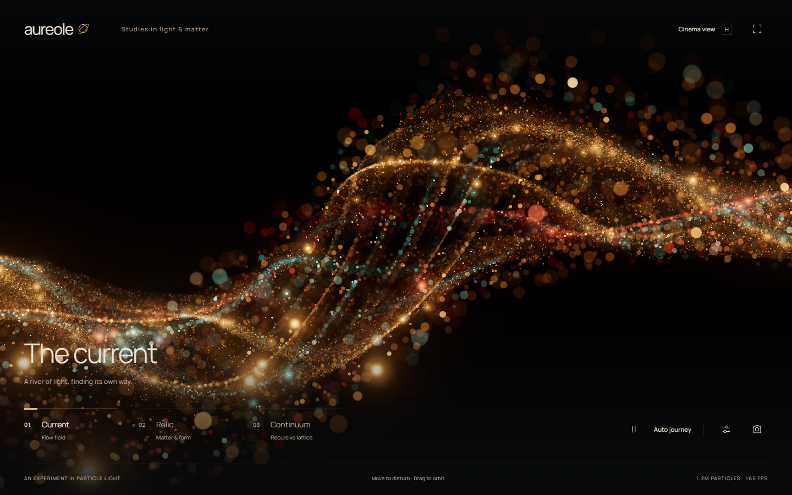
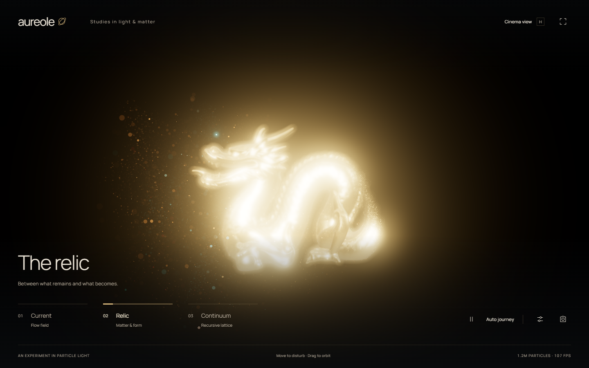
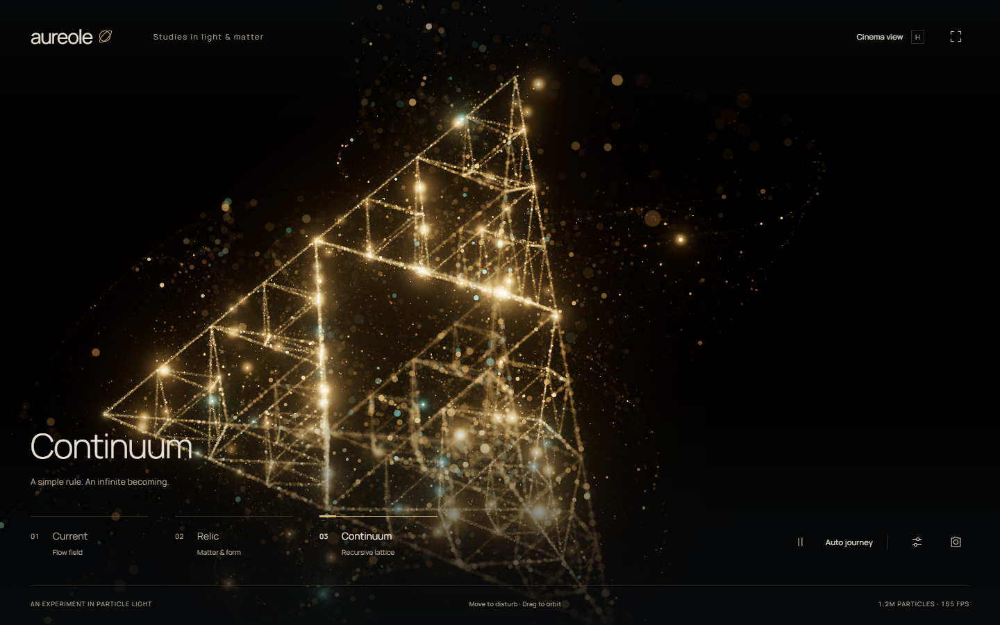

# Aureole

**Real-time studies in particle light — 1.2 million GPU-generated grains, HDR glitter, bloom and depth of field.**

Three interactive studies in particle light, inspired by the supplied Foundation opening references. Built with plain JavaScript, Three.js, custom GLSL and Vite. All artwork is rendered live; the screenshots below show actual demo output.



Actual WebGL output from the demo, with the default desktop particle count and effects enabled.

<details>
<summary>More scenes: Relic and Continuum</summary>





</details>

## Run

```sh
git clone https://github.com/sigman78/aureole.git
cd aureole
npm ci
npm run dev
```

Open the local URL printed by Vite (normally http://127.0.0.1:5173). Requires a current browser with WebGL 2, floating-point render targets and hardware acceleration. Dependencies, npm cache, build output and test artifacts stay inside the project. The Manrope font is served locally through its npm package, which includes its OFL license.

```sh
npm run build
npm run preview
npm test
```

The smoke test starts its own Vite server on port 5174 and reuses installed Microsoft Edge through Playwright; no browser download occurs. Set `BROWSER_CHANNEL` to another installed Chromium channel if needed. Screenshots, a PNG export and the hardware/frame-rate report are written under ignored `artifacts/`.

## Scenes and controls

- **Current:** braided particle streams, three-dimensional turbulence, foreground bokeh and pointer repulsion.
- **Relic:** Stanford dragon with particles sampled from its actual surface. Assembly reveals the solid while particles converge onto it; dispersal removes the solid and sends flakes into a wake.
- **Continuum:** recursive tetrahedral lattice made from granular edges, with assembly/dispersal and slow rotation.

Drag to orbit; scroll or pinch to zoom; move the pointer through the field to disturb it. Use **1 / 2 / 3** to select scenes, **Space** to pause, **H** to hide/show the interface, and **Escape** to close controls or leave cinema view. Native focused buttons retain their Space-key behavior.

The sliders control grain stabilization, bloom, exposure, depth softness, focus distance, flake roughness, glint strength, key-light position, turbulence, time scale and assembly. Assembly is available in Relic and Continuum. The assemble/disperse button animates the transition while running and applies immediately while paused. Automatic journey cycles scenes every 22 seconds. Save frame exports the artwork without interface chrome.

Reduced-motion preferences start the animation paused. Hidden tabs stop rendering. Detail levels use 120k / 600k / 1.2M / 2.4M particles, with 1.2M selected on desktop and 600k on smaller screens; resolution is capped separately to contain fill cost. Optional cinematic camera drift yields to orbit interaction and freezes when paused.

## What is physically motivated

Particles keep deterministic facet orientations. A GGX-shaped distribution, a Fresnel approximation and the light/view half vector produce angle-dependent glints. Bright values remain in linear half-float buffers through bloom, then pass through ACES tone mapping and sRGB conversion once. Depth-dependent particle splats conserve integrated profile energy as they expand into bokeh.

This is an artistic finite-flake approximation, not a complete physically based glitter BRDF. Extreme impulses are capped to reduce aliasing; particle light response lacks full transport and shadowing. The solid uses Three.js metallic PBR with an environment map and key/rim lights. Particle occlusion respects its depth, but defocused splats can still bleed at silhouettes. The solid receives depth-texture-based HDR blur; particles use energy-normalized aperture splats. Dense grains use temporal accumulation, while 12,000 sparse optical flakes are drawn afterward to preserve sparkle. Temporal reprojection approximates particle depth with the focus plane and has no per-particle motion vectors, so residual shimmer and motion artifacts remain possible. History resets during assembly changes. Flow and pointer response are analytic GPU deformations, not a fluid or collision simulation.

## Validation

The smoke suite checks all scenes, simulation pause, scene changes while paused, settings, palette, detail, reset, assembly endpoints, visible glint response, cinema mode, PNG export, reduced motion and mobile overflow. It records console/resource errors and renders desktop/mobile screenshots. Frame rates measure browser animation throughput; GPU timings use asynchronous disjoint timer queries where supported. Neither is a promise about other devices; see `artifacts/performance.json` for the latest machine-specific result.

## GPU particle generation

The desktop default now draws 1.2 million particles. Seeds, positions, motion and lighting are computed from `gl_VertexID`, with no per-particle attribute buffers. An area-weighted triangle atlas samples the dragon surface on the GPU. Fine grains use compact splats; a fixed 12,000-flake population gets larger bokeh footprints to bound fill cost. This is analytic animation, not persistent fluid simulation.

## Model attribution

The locally served dragon is derived from Khronos DragonAttenuation, originally Stanford University (1996), with cleanup by Morgan McGuire (2017). It is licensed for noncommercial/research use and free redistribution with attribution; commercial use requires permission. See [source and preparation details](public/models/SOURCE.md) and [license](public/models/LICENSE-Stanford.txt).

Reference analysis and primary research links are in [RENDERING.md](RENDERING.md); the original implementation plan is in [PLAN.md](PLAN.md).
